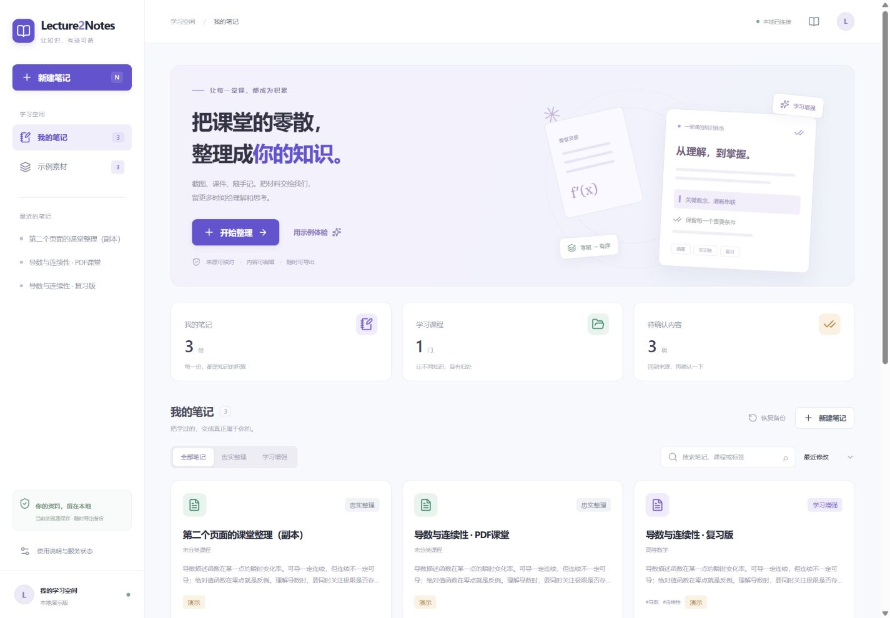

# Lecture2Notes

面向大学生的课堂笔记工作台。将截图、文本型 PDF 与课堂文字组织成有来源、可编辑、可导出的结构化笔记。



## 文档

- [详细 PRD](docs/PRD.md)
- [验收记录](ACCEPTANCE.md)
- [移动端截图](docs/images/mobile.jpg)
- [第三方组件说明](NOTICE.md)

此项目计划保存于个人私有仓库，不授予公开分发或开源使用许可。

## 启动

需要 Node.js 22.13+（建议 24）和 npm。

```bash
npm install
npm run dev
```

打开终端给出的地址，通常为 `http://127.0.0.1:5173/notes`。不需要 API Key 即可使用三组双模式样例以及自有文字/PDF 的模拟整理。

```bash
npm run typecheck
npm test
npm run build
```

项目使用 TypeScript、React、Next.js 页面约定、Vinext/Vite 运行与构建、Zod、IndexedDB、PDF.js 和 KaTeX。部署沿用 Sites 的 Cloudflare Worker 适配。页面路由包括 `/notes`、`/notes/new`、`/jobs/:id`、`/notes/:id`、编辑页和导出页。

## 已实现

- 六页完整流程，适配桌面和移动端。
- 三组自制样例：高数、管理学、概率条件冲突；忠实整理与学习增强有实质差异。
- 图片、PDF、TXT 和粘贴文本入口；文字和文本型 PDF 在浏览器真实提取。
- 内置截图按 SHA-256 匹配；未知图片在没有视觉服务时明确提示，不伪造识别。
- 任意文字/PDF 的演示生成只分段保留原文，并始终显示模拟标识。
- 标准化 Schema、引用归属和模式规则校验；置信度不冒充准确率。
- 来源片段/页码查看，原文件不可用时回退到来源快照。
- 草稿、搜索、筛选、笔记删除、自动保存、编辑前恢复快照、版本选择、revision 冲突处理。
- 任务取消、失败重试、刷新中断恢复、重复提交保护。
- Markdown、JSON 下载，JSON 备份恢复；浏览器打印/另存 PDF。
- 服务端模型和视觉识别适配器，有限重试与一次结构修复，不回退为虚假 Mock 成功。

## 真实模型配置

将 `.env.example` 复制为 `.env.local`，填写 `AI_API_KEY`、`AI_MODEL` 和模型服务 `AI_BASE_URL`，重启开发服务。所用服务需支持 `POST /chat/completions` 和 JSON 输出模式；视觉功能另填 `AI_VISION_MODEL`。不同服务的模型名及兼容性需按其文档配置。

在 Sites 托管时通过站点环境变量配置这些值，密钥设置为 secret，重新部署使其生效。不要把密钥粘贴到前端页面或提交到 Git。

页面“生成服务”会自动检测可用能力。真实生成前需确认本次材料文字的发送范围；图片识别需提前勾选外发授权。没有配置时，真实功能保持禁用，样例演示正常可用。

## 文件与数据

每次最多 10 份文件、单文件 20 MiB、总共 50 MiB、PDF 合计 50 页、文字 30,000 字符。单次生成使用保守的 16,000 字符输入预算，不默默截断。

资料存储在**当前浏览器 IndexedDB**。清理浏览器数据会清空资料；导出 JSON 可以备份文字和结构，但不包含原始 PDF/图片 Blob。浏览器关闭会中断本地任务，返回后可重试。

`public/samples` 提供自制 PDF、截图、TXT 和图像哈希映射。`scripts/prepare-assets.mjs` 从已安装的 PDF.js 复制浏览器 Worker、字符映射和许可证，构建与开发前自动执行。

## 目录

```text
app/                    六页路由和服务端 API
components/lecture/     工作台与页面组件
lib/lecture/            Schema、来源处理、Provider 调用、任务与存储
public/samples/         可下载的自制演示素材
scripts/prepare-assets.mjs
tests/domain.test.ts    结构、引用、模式和导出验证
```

## 当前交付边界

此版本完成 PRD 的本地应用闭环，并提供真实服务适配。未获得用户模型密钥，因此真实外部模型/OCR 的端到端质量未实测。扫描 PDF OCR、长文分层归纳、云端同步、多人协作和付费未在本期实现。

独立 GitHub 副本不含原 Sites 项目 ID，尚未从此副本部署；笔记保存在浏览器；这不等于完成 PRD M2 的多人云存储和持久化任务系统。对外开放前应实现数据库级身份隔离、持久化任务与分布式配额。当前服务端内存限流属于单实例保护，不能当作全局配额。

简历和个人联系信息未打包到产品样例中。
